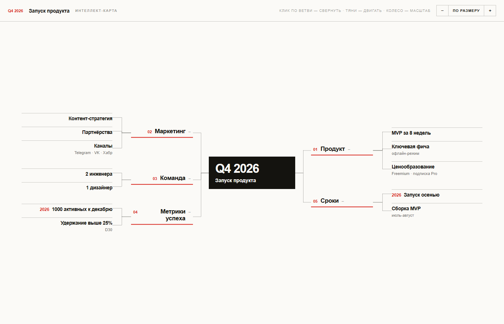

# Интеллект-карты

Интерактивные интеллект-карты (mind maps) в виде HTML-файлов.
Открываются в любом браузере, карту можно двигать и масштабировать.

## Демо

Открывается живым сайтом на GitHub Pages:
[Запуск продукта (карта)](https://nftshich.github.io/mind-maps/запуск-продукта-карта.html)

## Превью

## Как использовать

1. Откройте `.html` в браузере.
2. Отредактируйте содержимое (структуру, тексты, цвета) — файл самодостаточный,
   без внешних зависимостей.
3. Разместите на любом хостинге или GitHub Pages.

Карта интерактивная: поддержка масштабирования и перетаскивания.